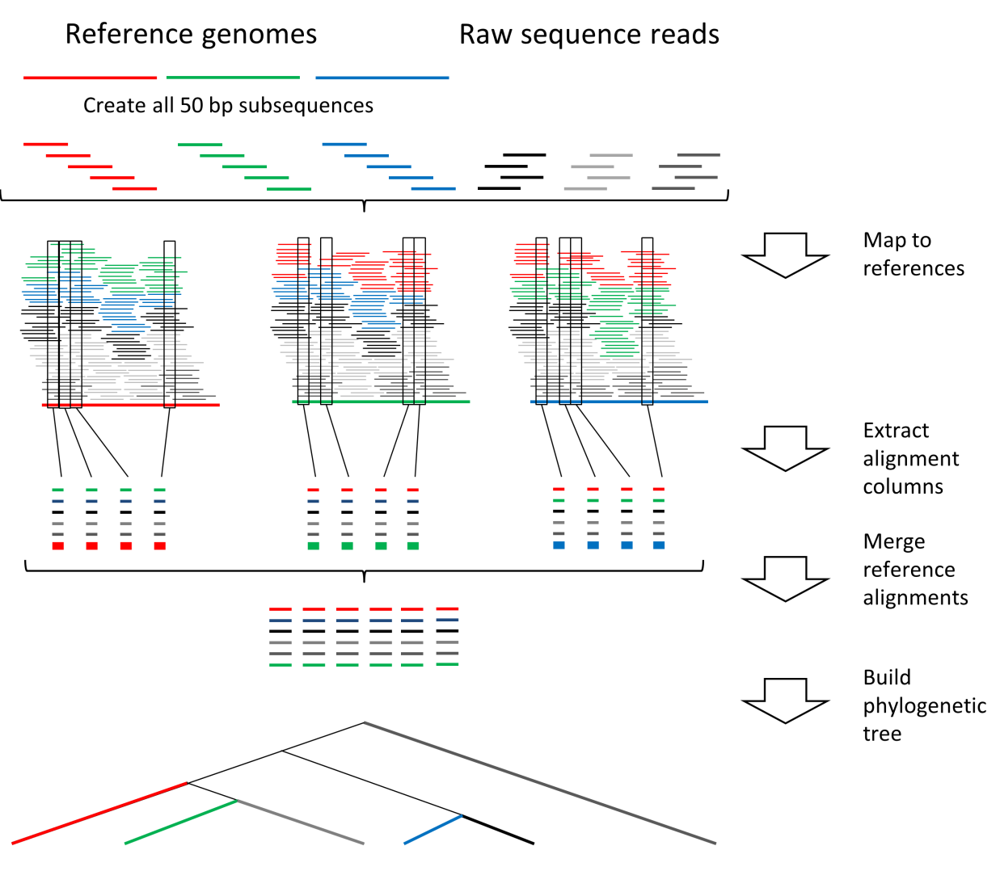

# Installation

## Requirements

The program requires several other programs in order to run. These are:

- JAVA downloadable from: <http://www.java.com/> (Java 8 or newer is required to run RealPhy; building from source needs JDK 9 or newer)
- Bowtie2 downloadable from: <http://bowtie-bio.sourceforge.net/bowtie2/index.shtml> (works with version 2.0.0-beta7)

To save disk space it is possible to store alignment files in BAM format. In this case the samtools program is required. This program can be downloaded under: <http://samtools.sourceforge.net/>.

A few more programs can be run by REALPHY if desired *(Note: Either TREE-PUZZLE, RAxML, PHYML, IQ-TREE or dnapars is needed to build a tree)*:

- TREE-PUZZLE downloadable from: <http://www.tree-puzzle.de/> (works with version 5.2)
- RAxML downloadable from: <https://github.com/stamatak/standard-RAxML> (works with version 7.3.0)
- PHYML downloadable from: <http://www.atgc-montpellier.fr/phyml/binaries.php> (works with version 3.1)
- IQ-TREE downloadable from: <http://www.iqtree.org/> (a version that understands the `-T` option, e.g. IQ-TREE 2; the executable is usually called `iqtree` or `iqtree2`)
- Dnapars as part of the phylip suit of programs. Downloadable from: <http://evolution.genetics.washington.edu/phylip/executables.html>

The above programs can be installed anywhere on the computer, however the location and name of the executable needs to be specified in a config file called `config.txt`. An example of a config file can be found below:

```
BOWTIE2 /home/smith/Programs/bowtie2/bowtie2
BOWTIE2BUILDER /home/smith/Programs/bowtie2/bowtie2-build
TREEPUZZLE /home/smith/Programs/TREE-PUZZLE/bin/puzzle
RAXML /home/smith/Programs/RAxML/bin/raxmlHPC-SSE3
Rscript /home/smith/Programs/R-2.15.2/bin/Rscript
MaxPars /home/smith/Programs/phylip-3.69/exe/dnapars
PhyML /home/smith/Programs/PhyML-3.1/PhyML-3.1_linux64
IQTree /home/smith/Programs/iqtree/bin/iqtree
```

The config file then needs to be placed into the designated output folder (which is specified as a command line parameter) before REALPHY can be run.

Please cite the following paper if you used REALPHY:

> Bertels F., Silander O.K., Pachkov M., Rainey P.B., and van Nimwegen E. (2014) Automated reconstruction of whole genome phylogenies from short sequence reads. Molecular Biology and Evolution. doi:10.1093/molbev/msu088.

Please cite the following paper if you used bowtie2 for read mapping:

> Langmead,B. and Salzberg,S.L. (2012) Fast gapped-read alignment with Bowtie 2. Nature Methods, 9, 357--359. doi: 10.1038/nmeth.1923.

If you used RAxML to build the tree please cite:

> Stamatakis,A. (2006) RAxML-VI-HPC: maximum likelihood-based phylogenetic analyses with thousands of taxa and mixed models. Bioinformatics, 22, 2688--2690. doi: 10.1093/bioinformatics/btl446.

If you used PhyML to build the tree (default setting) please cite:

> Guindon,S., Dufayard,J.F., Lefort,V., Anisimova,M., Hordijk,W., Gascuel,O. (2010) New Algorithms and Methods to Estimate Maximum-Likelihood Phylogenies: Assessing the Performance of PhyML 3.0. Systematic Biology, 59(3), 307-21.

If you used IQ-TREE to build the tree please cite:

> Minh,B.Q., Schmidt,H.A., Chernomor,O., Schrempf,D., Woodhams,M.D., von Haeseler,A., Lanfear,R. (2020) IQ-TREE 2: New Models and Efficient Methods for Phylogenetic Inference in the Genomic Era. Molecular Biology and Evolution, 37(5), 1530--1534. doi: 10.1093/molbev/msaa015.

If you used TREE-PUZZLE please also cite:

> Schmidt,H.A., Strimmer,K., Vingron,M., and von Haeseler,A. (2002) TREE-PUZZLE: maximum likelihood phylogenetic analysis using quartets and parallel computing. Bioinformatics, 18, 502--504.

If you used samtools then please also cite:

> Li,H., Handsaker,B.\*, Wysoker,A., Fennell,T., Ruan,J., Homer,N., Marth,G., Abecasis,G., Durbin,R. and 1000 Genome Project Data Processing Subgroup. (2009) The Sequence alignment/map (SAM) format and SAMtools. Bioinformatics, 25, 2078-9.

If you used Dnapars from the phylip suit please cite:

> Felsenstein,J. (2009). PHYLIP (Phylogeny Inference Package) ver. 3.69.

## Building RealPhy from source

The RealPhy source code is written in Java. A ready-made `RealPhy.jar` can be created from the source tree with the script `build.sh` in the top folder of the repository. The script only needs a Java Development Kit (JDK 9 or newer, providing `javac` and `jar`; the resulting jar runs on Java 8 or newer) and a bash shell. The two libraries that RealPhy depends on (`RCaller` and `sam`) are supplied in the `lib` folder, so no internet connection is needed:

```
./build.sh
```

The script compiles all sources for Java 8, unpacks the libraries from `lib` and packages everything into the single, standalone file `RealPhy.jar` in the top folder of the repository. The intermediate class files are kept in the `bin` folder and the list of compiled sources in `sources.txt`; both are re-created at every run. To check that the build was successful run:

```
java -jar RealPhy.jar -version
```

# Quickstart

The program can be run as follows (you may have to adjust the version number; a jar built with `build.sh` is simply called `RealPhy.jar`):

```
java -jar -Xmx2000m RealPhy_v114.jar \
  <sequence folder> <output folder> [options]
```

Or you can use the shell script in the RealPhy folder to start REALPHY:

```
REALPHY_v114 \
  <sequence folder> <output folder> [options]
```

For example, to align the sequences in the folder `./seqs` using four threads and to build the tree with IQ-TREE, writing all results to the folder `./out`, copy the following commands (adjust the paths to your system). The file `config.txt` must be in `./out` and must contain the lines for BOWTIE2, BOWTIE2BUILDER and IQTree (see above):

```
mkdir -p out
cp config.txt out/
java -jar -Xmx2000m RealPhy.jar ./seqs ./out \
  -treeBuilder 5 -thread-num 4
```

To only run the alignment step, add `-alignment-only`:

```
java -jar -Xmx2000m RealPhy.jar ./seqs ./out \
  -thread-num 4 -alignment-only
```

The only mandatory arguments are the path to the folder that contains the sequence data and a path to the folder, where the output files will be placed. The options are preset and do not necessarily need to be supplied. The `-Xmx` option specifies the maximum amount of RAM that Java can use to execute RealPhy.jar. For small projects (10-20 bacterial genomes) 2GB should suffice, however if there are hundreds of input genomes more RAM will be needed. However this requirement changes once the merge option is set to true, which increases the RAM requirement significantly with increasing number of reference genomes.

With the default parameters the program assumes that within the sequence folder there is at least one FASTA file (extension `.fas`, `.fasta`, `.fna` or `.fa`) or Genbank file (extension `.gbk` or `.gb`) that contains a reference sequence. Then a random sequence (FASTA or Genbank file) is selected as reference. A folder named after the prefix of the reference file is created in the designated output folder. In this folder all results are going to be stored. If the `-genes` option is set then all genes that are annotated in the Genbank file as CDS are extracted from the sequence and placed into a newly created folder named `core`, which is a subfolder of the reference folder in the output folder (i.e. `<outputFolder>/<reference>/core/`). If the `-genes` option is not set (default) then the randomly selected reference sequence will be placed into the `core` folder. The remaining FASTA and Genbank sequence files are chopped into 50 bp fragments and placed into a subfolder named `cut` within the sequence folder. These sequence fragments together with the `.fastq` (`fastq.gz`, `R1.fastq.gz`/`R2.fastq.gz`) files are then aligned via bowtie2 to the reference sequence (several sequence files can be aligned at the same time, see option `-thread-num`). For bowtie2 SAM alignments are created. If the program samtools (<http://samtools.sourceforge.net/>) is installed then these alignments are immediately transformed into BAM files. From these alignments a site (codon or nucleotide sites) is extracted if the position of the polymorphic site in all query sequence files is covered by at least 10 fragments, and each nucleotide of at least 10 fragments has a quality score of at least 20 ('A' in ASCII, PHRED+33). Furthermore, in each query sequence alignment at least 95% of the nucleotides that cover each site of a reference site need to agree for this site to be included in the polymorphic output sequence. Once the site underwent quality control the output sequence is stored in a subfolder named `PolySeqOut_NoGenes` (or `PolySeqOut` if the `-genes` is not set), which is found in the same folder as the `core` folder. This sequence is translated into PHYLIP format and used as input file for the tree building program. All output files from the tree building program are also placed into the `PolySeqOut_NoGenes` folder (see below).

# REALPHY folder structure

## The sequence folder

The sequence folder needs to contain sequences in FASTQ, FASTA or Genbank format. If the option `-genes` is set then the program requires at least one data set for which a genbank file is available. If the `-genes` option is not set then the program only needs at least one sequence to be in FASTA format onto which the remaining data sets can be aligned. FASTQ files need to end in ".fastq" or ".fastq.gz" or for paired end data in "R1.fastq.gz" and "R2.fastq.gz", FASTA files in ".fas", ".fasta", ".fna" or ".fa" and genbank files in ".gbk" or ".gb". If the `-genes` option is set then the Genbank file needs to contain CDS information, so individual gene sequences can be extracted. Ideally, the prefixes of the sequence files should be shorter than ten characters. This is important because the prefixes will be used to name the generated polymorphism sequences, which in turn will be transformed into PHYLIP format for the subsequent generation of phylogenetic trees. The PHYLIP format does not allow sequence identifiers to be longer than ten characters. If the `-genes` option is set then individual gene sequences are extracted from the reference genome otherwise the selected reference genome is simply copied into the `core` folder (see below). Furthermore, all FASTA or Genbank query sequences are fragmented into short sequences of specified length (see option `-readLength`) and placed into a subfolder named `cut`. The fragmented sequences are later aligned to the extracted reference genes or the reference genome.

## The output folder

The output folder needs to contain the `config.txt` file, which specifies the locations of the required programs (as explained above). The REALPHY program will then create a subfolder named after the prefix of the reference sequence file. Within this folder three subfolders will be created.

The first is named `alignOut` or `alignOut_NoGenes`. This folder will be used to deposit the bowtie2 alignments for each sequence file in the sequence folder. All alignment files have the extension ".sam" or ".bam" (if samtools are installed, and available on the command line) and the same prefix as the corresponding input sequence.

The second is named `core`. In this folder the reference files are placed as well as the bowtie2 index files. If the `-genes` option is set, then there are two copies of the core gene set file. The first is named `core+[ReferencePrefix].fas` and only contains the sequences of the reference sequence's open reading frames. The second file is named `core+[ReferencePrefix]Flank[N].fas`. This file contains the reference sequence's open reading frames plus flanking sequences of length N. N denotes the fragment length, which can be specified with the command line option `-readLength` and is set to 50 by default. For this file bowtie2 index files are created against which the fragmented input sequence files are aligned. If the option `-genes` is not set then the reference genome is simply copied into the `core` folder.

The third folder is named `PolySeqOut_NoGenes` or `PolySeqOut`. In this folder the final output files will be placed. These include:

- `polymorphisms.fas`

    This is the first output file from REALPHY and contains a sequence of conserved nucleotide sites or codons for each input sequence file.

- `polymorphisms_move.fas`

    It contains the same sequences as `polymorphisms.fas`, except that the sequence that was specified by "`-root`" is moved to the top of the file.

- `polymorphisms_move.phy`

    The same as `polymorphisms_move.fas` but in PHYLIP format so it can be used as input for RAxML, dnapars, PhyML and TREE-PUZZLE.

- `polymorphisms_move.phy.puzzle`

    TREE-PUZZLE output. It contains statistics gathered while building the phylogenetic tree.

- `polymorphisms_move.phy.tree`

    TREE-PUZZLE output. It contains the phylogenetic tree built from the polymorphic sequences.

- `polymorphisms_move.phy.dist`

    TREE-PUZZLE output. Distance file.

- `RAxML_bestTree.raxml`

    RAxML output. Contains the best scoring maximum likelihood tree calculated by RAxML.

- `RAxML_info.raxml`

    RAxML output. Contains statistics about the RAxML run.

- `polymorphisms_move.tree`

    Dnapars output. If maximum parsimony was selected as tree building method (`-treebuilder 3`) this file contains the tree calculated by dnapars from the phylip program suit.

- `polymorphisms_move.phy_phyml_tree.txt`

    PhyML output. If PhyML was selected as tree building method (`-treebuilder 4`) this file contains the maximum likelihood tree. Newer PhyML versions name this file `polymorphisms_move.phy_phyml_tree` (without the `.txt` extension); REALPHY recognises both names.

- `polymorphisms_move.phy_phyml_stats.txt`

    PhyML output. Contains statistics for a PhyML run.

- `polymorphisms_move.phy.treefile`

    IQ-TREE output. If IQ-TREE was selected as tree building method (`-treeBuilder 5`) this file contains the maximum likelihood tree. A copy of this file is also written as `polymorphisms_move.phy_phyml_tree.txt`, so that downstream scripts written for PhyML output keep working.

- `polymorphisms_move.phy.iqtree`, `polymorphisms_move.phy.log`, `polymorphisms_move.phy.mldist`, ...

    IQ-TREE output. Report, log and distance files of the IQ-TREE run.

- `*details.txt`

    For each input sequence a file is created with the prefix of the input sequence and the suffix "details.txt". These files contain information about the conserved sites that were detected for this particular input sequence relative to the reference sequence. Sites are only reported in regions of the reference genome that are covered by at least n (set by parameter `-perBaseCov`) high quality (set by parameter `-quality`) sequence fragments, sites that were conserved in at least a proportion of X (between 0 and 1) of the reads (set by parameter `-polyT`) and in genes of which at least Y% are covered by reads (set by parameter `-percentCov`). These conditions have to be fulfilled for all input sequences. "Details" files have the following file format:

    ```
    Strain  Contig     Gene  RefPos  Pos  Orig  Poly
    JpWa1   Scaffold1  1     339     54   G     T
            CCG=P CCT=P
    ```

    The first column (`Strain`) shows the prefix of the input sequence. The second column (`contig`) shows the name of the scaffold (individual sequence from the original reference FASTA sequence). The third column (`Gene`) shows either the scaffold again (`-genes` not set) or the number of the extracted gene. The gene number corresponds to the number in the core gene set file (see output folder `core`). The fourth column (`RefGeneStartPos`) shows the starting position of the gene within the reference genome. The fifth column (`RefGenePos`) shows the position of the polymorphism within the gene. The sixth column (`RefGenomePos`) shows the position of the polymorphism in the reference genome. The seventh column (`Orig`) shows the nucleotide at that position in the reference genome. The eighth column (`Poly`) shows the polymorphic nucleotide in the input sequence. The last two columns show the codon and the amino acid that is encoded as well as the codon and amino acid that it is changed into (only if `-genes` is set). These files are tab delimited and hence can be imported into EXCEL or similar programs.

- `*_genePoly.txt`

    If `-genes` is set, for each input sequence a file with the suffix "`_genePoly.txt`" is created. This file contains a summary of the numbers of synonymous and non-synonymous changes that were detected in each reference gene. However this is not a comprehensive list of all existing polymorphisms but only contains polymorphisms that were detected with the given constraints of the REALPHY approach. All files contain the following information specific to the corresponding input sequence:

    ```
    Strain  Gene  RefPos  Syn  NonSyn  ratio     geneLength  poly\geneLength
    JpWa2   1     339     2    0       Infinity  1536        0.001953125
    ```

    The first column (`Strain`) shows the prefix of the input sequence. The second column (`Gene`) shows the number of the gene. The gene number corresponds to the number in the core gene set file (see output folder `core`). The third column (`RefPos`) shows the starting position of the gene within the reference genome. The fourth column (`Syn`) contains the number of detected polymorphisms that caused no change in encoded amino acid in relation to the reference sequence. The fifth column (`NonSyn`) contains the number of detected polymorphisms that caused a non-synonymous change within the codon. The sixth column (`ratio`) shows the ratio between synonymous changes and non-synonymous changes. The seventh column (`geneLength`) shows the length of the gene and the last column (`poly/geneLength`) shows the number of polymorphisms divided by the length of the respective gene.

- `coreGenomeSize.txt`

    This file contains information on how the core genome shrinks as more and more sequences are added. The file structure looks like this:

    ```
    W3110       4507328/4646332|4507324
    ```

    The first column contains the strain name. The second column consists of three subsets. The first number is the number of nucleotide sites that were mapped to the reference genome with a coverage greater than the specified minimum (`-perBaseCov`). The second set is the length of the reference genome. The last set is the number of orthologous sites that are still considered at this point in the analysis. These are all sites that have not yet been excluded from the analysis (e.g. if region is missing or ambiguous in the same strain or other preceding strains).

- `polies_and_orthologous_sites.txt`

    This file contains information about the ratio between polymorphisms and mapped sites and the predicted proportion of SNPs that is likely to get lost due to reference alignment bias. The file structure looks like this:

    ```
    IAI1|4152086|48958|0.011791181589206005|3.132251704215286E-5
    ```

    The first column is the strain name. The second column is the number of nucleotides mapped to the reference genome. The third column is the number of identified SNPs. The fourth column is the ratio between SNPs and the number of mapped nucleotide sites. The last column is the predicted proportion of SNPs that is likely to get lost, based on results from simulations.

- `coverage.txt`

    This file contains information about genome coverage. The file structure looks like this:

    ```
    AP009048; 0
    ```

    The first column is the name of the contig (names designated in FASTA or Genbank file of the reference). The second column consists of 0s and 1s. If the nth line is 0 then the nth nucleotide is not covered. If it is 1 then the nth nucleotide is covered.

- `*deletedSites.txt`

    For each query genome this file contains information on the sites in the reference genome that were excluded from the analysis due to a low rate of polymorphisms. This means although the coverage at those sites was above the threshold, the proportion of polymorphic sites was lower than 95% but higher than 5%. This file type is for example useful for analysing sequencing files for contamination.

    The file structure looks like this:

    ```
    AP009048;  302  -  49.0  39.0  0.7959183673469388
    ```

    The first column is the name of the query contig.

    The second column denotes the position on this contig.

    The third column denotes the most common polymorphic site.

    The fourth column denotes the coverage on this site.

    The fifth column denotes the frequency of the most common polymorphic nucleotide/gap.

    The sixth column denotes what proportion the most common polymorphism of the overall coverage takes up.

# REALPHY algorithm

{width=80%}

The flowchart above shows the individual processes that are started by the REALPHY program. First of all the input sequences have to be provided by the user in a designated folder. Then the program checks if the core gene set or reference genome already exists. If not it is being created either by simply copying the reference genome to a designated folder (default), by extracting genes from a designated annotated reference genome (`-genes`). The program also checks if the input sequences have already been fragmented and placed into a subfolder within the sequence folder called `cut`. If not it will create the folder and place the fragmented sequences into the `cut` folder. The fragmentation of the input sequences is done differently for FASTA/GBK and FASTQ sequences. FASTA/GBK sequences are cut into all possible n-mers (specified by `-readLength`), since it is assumed that FASTA/GBK sequences are virtually error less and each base is supported by multiple different sequences. FASTQ sequences are not altered.

Once the fragmented sequence files as well as the reference sequence file have been created the fragmented sequence files are aligned to the reference via bowtie2 unless alignment files are already present in the `alignOut_NoGenes` or `alignOut` folder. From these alignment files polymorphic sites (codons or single nucleotides) are extracted that contain at least one polymorphism in one of the input sequence data sets. The polymorphic sites then undergo a quality check, which checks that: (1) all identified regions are present in all input sequences (covered by at least `-perBaseCov` nucleotides); (2) no sites are included where the query sequences match to multiple regions in the reference genome; (3) sites are also excluded if multiple different nucleotides align to that position for any input sequence (see option `-polyT`); (4) only sites are included that are covered by high quality bases for all input sequences (see option `-quality`); and (5) all genes are excluded where not at least a proportion of X of the reference gene/genome is covered by reads (X can be specified by `-percentCov`, only relevant if `-genes` is set). All sites that successfully underwent quality control are then concatenated into a sequence. If the option `-gaps` is set then for each site a certain proportion of the input sequences at this site (can be set via `-gapThreshold`, is set to all by default) is allowed to be ambiguous (i.e. the nucleotide at this position is either unknown or does not exist in the query sequence). This ambiguity is indicated within the alignment by a dash. The resulting polymorphic sequence is then used either as input for TREE-PUZZLE (`-treeBuilder 1`), for RAxML (`-treeBuilder 2`), for maximum parsimony dnapars from the phylip suit is run (`-treeBuilder 3`), for PhyML (`-treeBuilder 4`), or for IQ-TREE (`-treeBuilder 5`) to build a phylogenetic tree. Maximum parsimony and TREE-PUZZLE are run with standard settings and TREE-PUZZLE uses HKY85 as the evolutionary model. RAxML is run as follows:

```
raxmlHPC-SSE3 -s polymorphisms_move.phy \
  -w <output directory/referenceStrainName/PolySeqOut/> \
  -m GTRGAMMA -p 12345 -n raxml -o <root if specified>
```

PhyML is run as follows:

```
PhyML-3.1_linux64 -i polymorphisms_move.phy \
  --r_seed <random number> -m GTR -b 0
```

IQ-TREE is run as follows:

```
iqtree -s polymorphisms_move.phy -m GTR \
  -T <thread number> -seed <random number>
```

Options that are given in the file specified by `-treeOptions` (see below) replace the corresponding defaults of RAxML, PhyML and IQ-TREE and other options are appended to the command line. For IQ-TREE the prefix options `-pre` and `--prefix` are ignored, because REALPHY expects the output files to have the default names.

The alignment step can be run on several threads. The sequence files are fragmented and aligned to the reference by up to `-thread-num` parallel jobs (every bowtie2 job runs on one CPU core), and the same number of threads is given to IQ-TREE. To only perform the alignment and stop before polymorphisms are extracted, use `-alignment-only`.

Further options include:

`-root`, which allows the user to specify the input sequence that is going to be the outgroup in the tree reconstruction step;

`-refN`, by using this option the user can specify what genome will be used as reference genome; N in this case stands for an integer between 1 and 500; hence the user can select multiple reference genomes for which the analysis will be run.

`-clean` if set all previously created intermediate outputs will be overwritten. These include fragmented sequence files in the `cut` folder, reference genome/gene set and the alignment out bam/sam files. This option is useful when an earlier run of the program was unexpectedly aborted or if sequence files changed.

`-quiet` all output is suppressed if set, except for warnings and error messages.

`-config` specifies the location of the config file.

`-merge` If more than one reference is provided this option combines the alignments of each reference into an overall multiple sequence alignment. From this sequence alignment a tree is inferred, which should in principle reduce the effect of reference alignment bias (see publication). However, this option is extremely time and RAM intensive and should only be used for a low number of reference genomes.

# Options

Usage:

```
java -Xmx[available RAM in MB]m -jar RealPhy_v1.14.jar \
  [Sequence folder] [Output folder] [Options]
```

Sequence folder needs to contain fasta files ending with `.fas`, `.fna`, `.fasta` or `.fa`, genbank files ending in `.gbk` or `.gb` and short read files in fastq format ending in `.fastq` or `fastq.gz`.

The output folder needs to contain a file called "config.txt", which contains information about the location of the required executables such as bowtie2.

Options:

`-readLength [integer]` default=50 Possible values: Integer greater than 30; Size of fragments that are to be produced from the FASTA/GBK input sequences. With longer read lengths the mapping will take longer but will also map more divergent sequences.

`-quality [integer]` default=20; Possible values: Integer value between 0 and 41 that corresponds to quality values in fastq files. Bases with values below thresold in fastq file will not be considered (fasta files will be converted into fastq files with a quality of 20).

`-polyThreshold [double]` default=0.95; Possible values: Double value between 0 and 1. Polymorphisms that occur at lower frequency than the specified threshold at any given position of the alignment will not be considered.

`-perBaseCov [integer]` default=10; Possible values: Integer greater than or equal to 10. Polymorphisms will only be extracted for regions that are covered by more than the set threshold of reads.

`-ref [sequence file name (without extension or path!)]` default=random; Possible values: The file name of a sequence data set without the extension (.fas, .fasta, .fa, .fna, .fastq, .fastq.gz, .gb or .gbk). Sets the reference sequence.

`-root [sequence file name (without extension or path!)]` default=random; Possible values: The file name of a sequence data set without the extension (.fas, .fasta, .fa, .fna, .fastq, .fastq.gz, .gb or .gbk). Specifies the root of the tree.

`-refN [sequence file name (without extension or path!)]` where N is the n-th reference genome; default=not set; Possible values: The file name of a sequence data set without the extension (.fas, .fasta, .fa, .fna, .fastq, .fastq.gz, .gb or .gbk).

`-genes` If set then genes (CDS) are extracted from a given genbank file.

`-gapThreshold [double]` default=0; specifies the proportion of input sequences that are allowed to contain gaps in the final sequence alignment (i.e. if set to 0.2 at most 20% of all nucleotides in each final alignment column are allowed to be gaps).

`-clean`/`-c` If set then the whole analysis will be rerun and existing data will be overwritten!

`-treeBuilder [integer]` default=4;

- 0=Do not build a tree;
- 1=treepuzzle;
- 2=raxml
- 3=max. parsimony (dnapars)
- 4=PhyML (default)
- 5=IQ-TREE

`-quiet`/`-q` If set then it suppresses any program output except for errors or warnings.

`-varOnly`/`-v` If set then homologous positions that are conserved in all input sequences are put out. If set then the reconstructed tree may be wrong.

`-seedLength [integer]` default=22 Possible values: Integer between 4 and 32; specifies k-mer length in bowtie2.

`-thread-num [integer]` default=1; Possible values: Integer greater than or equal to 1; number of threads used by the aligner. Up to this number of sequence files are fragmented and aligned in parallel. The same number is passed to IQ-TREE (`-T`) unless `-T` or `-nt` is given in the `-treeOptions` file.

`-alignment-only` If set then only sequence alignment is performed, no polymorphism extraction or tree reconstruction.

`-suffix [string]` default=not set; appends a suffix to the reference output folder.

`-d`/`-delete` If this option is set then all alignment output files and sequence cut files will be deleted after the program is terminated.

`-merge`/`-m` If this option is set multiple references are selected, a final polymorphism file will be generated which combines all polymorphism files for all references.

`-gaps`/`-g` If this option is set. The gapThreshold is automatically set to 100%, unless a different gapThreshold is specified.

`-config [string]` this specifies the location of the config.txt. If not set it is assumed that the config.txt is in the working directory.

`-treeOptions [text file]` This option allows the user to provide command line parameters to the tree program (RAxML, PhyML or IQ-TREE) in the first line of a given text file.

`-bowtieOptions [text file]` This option allows the user to provide command line parameters to bowtie2 in the first line of a given text file.

`-h`/`-help` Shows this help.

`-version` Prints the program's version.
